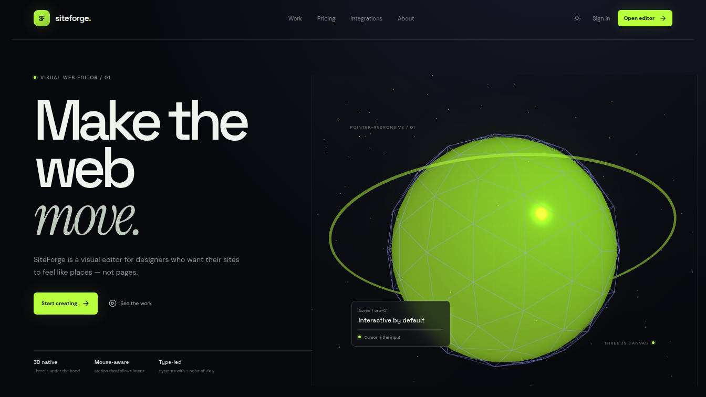

# SiteForge

SiteForge é um editor visual de websites com foco em composição 3D, movimento e direção de arte. O projeto permite montar páginas visualmente, organizar camadas, editar tipografia e cores, visualizar diferentes dispositivos e experimentar cenas interativas com Three.js.

> Este projeto foi criado usando **vibecoding**: uma abordagem iterativa de desenvolvimento orientada por intenção, exploração visual, prototipagem rápida e refinamento contínuo com auxílio de inteligência artificial. O código continua aberto para revisão, evolução e colaboração da comunidade.




## Objetivo

O objetivo do SiteForge é aproximar a criação de websites da linguagem de ferramentas visuais como After Effects, Figma e outros ambientes de composição: uma pessoa deve conseguir construir uma superfície digital com identidade, movimento e elementos 3D sem começar por uma tela vazia de código.

O foco atual está em:

- edição visual de páginas, camadas, tipografia, cores e composição;
- cenas 3D interativas com Three.js e resposta ao ponteiro;
- preview desktop, tablet e mobile;
- persistência de projetos por usuário;
- autenticação oficial Manus para proteger o workspace;
- gerenciamento de servidores MCP dentro do editor;
- interface pública em português, inglês e espanhol;
- tema claro e escuro.

## Stack

- React + TypeScript + Vite
- Three.js
- Express 5
- MySQL via `mysql2` quando `DATABASE_URL` está disponível
- Manus OAuth e JWT para sessão
- Lucide React para ícones

## Execução local

```bash
npm install
npm run dev
```

O servidor de desenvolvimento escuta na porta `3000`. Para validar uma versão compilada:

```bash
npm run build
npm run preview
```

Variáveis usadas pelo login Manus e pela persistência podem ser configuradas no ambiente de execução. Não inclua segredos no repositório.

## Estrutura principal

```text
src/
  App.tsx          Editor protegido, projetos, autenticação e MCP
  PublicSite.tsx   Site público e páginas institucionais
  main.tsx         Roteamento por pathname
  styles.css       Sistema visual e responsividade
server/
  index.mjs        Runtime Express, Manus OAuth e API de projetos
  db.mjs           Schema e persistência de usuários/projetos
public/
  manus-routes.json Manifesto de rotas do Preview
```

## Vídeo de anúncio


## Estado do projeto

O SiteForge é um protótipo funcional em evolução. A contribuição mais útil neste momento é melhorar a arquitetura do editor, adicionar componentes visuais reutilizáveis, ampliar a persistência de projetos, fortalecer testes e propor novas interações 3D sem perder a clareza da interface.

Consulte [`README_for_contributors.md`](README_for_contributors.md) para orientações de colaboração.

## Licença

A licença ainda deve ser definida pelos mantenedores antes de uma distribuição pública formal.
